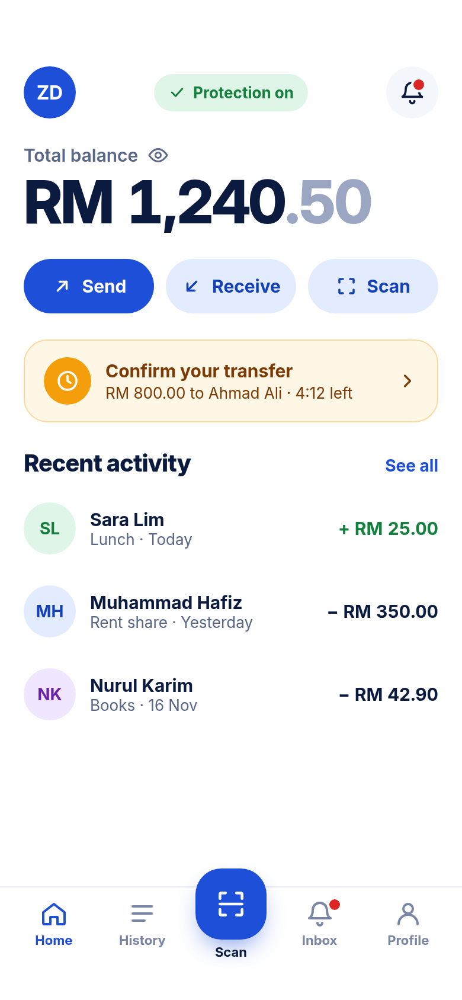
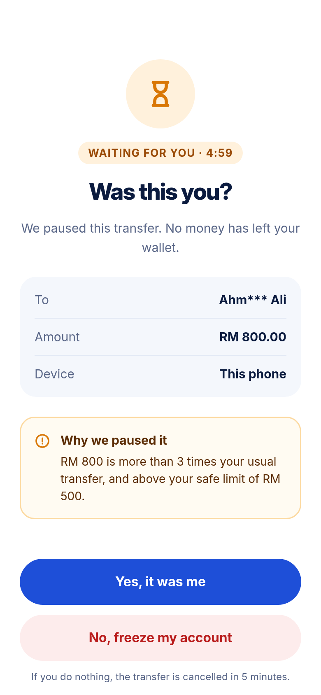
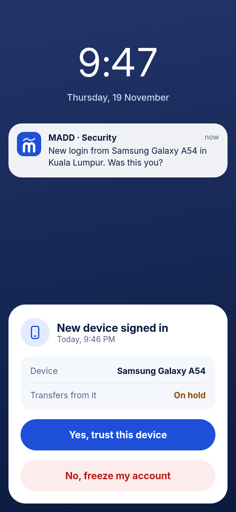
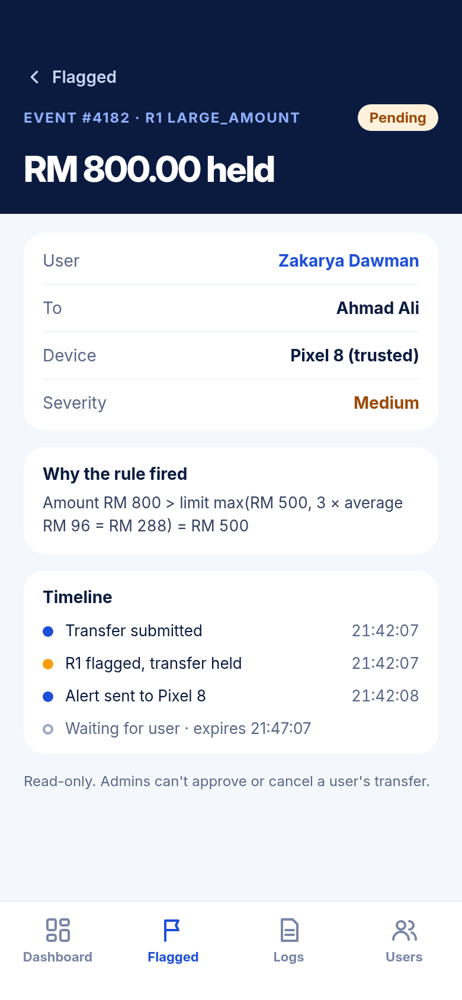

# MADD (مدّ): a wallet that keeps checking after you log in

MADD is a secure Android e-wallet. Most e-wallets check you once, at login. MADD checks **every transfer** with four rules on the server. When something looks unusual, the transfer is **held**, no money moves, and the owner decides: *Yes, it was me* (with their PIN) or *No, freeze my account*.

> Final Year Project, BSc (Hons) Computer Science (Cybersecurity), Asia Pacific University (APU).
> **Zakarya Zaben Ullah Nasser Dawman** (TP079346) · Supervisor: Ts. Umapathy Eaganathan

*Madda* (مدّ) is the Arabic mark that makes a sound longer. MADD makes protection longer: past the moment you log in.

<p>
  
  
  
  
</p>

## The four rules

| Rule | Fires when | What happens |
|---|---|---|
| **R1** Large amount | amount > max(RM 500, 3 × the user's average transfer) | Transfer held |
| **R2** Velocity | more than 3 transfers within 5 minutes | Transfer held |
| **R3** Unknown device | the phone is not one of the user's trusted phones | Its transfers wait for the usual phone |
| **R4** Failed logins | 5 wrong passwords within 15 minutes | Sign-in locked for 15 minutes |

- A held transfer expires after **5 minutes**. No money moves unless the owner says yes.
- **5 wrong PINs** in a row lock transfers for 15 minutes.
- Alerts go to the owner's **trusted phones only** (push + in-app Inbox).
- Each rule is a pure function in `server/src/rules/`, with its own tests. All thresholds live in `server/src/rules/config.ts`.

## Features

**Customer app (Android):** sign up with a 6-digit PIN · balance · send money · receive with a QR code · scan to pay · history · held transfers with Yes/No · new-device approval · Inbox with security alerts · freeze my account.

**Admin web console:** dashboard · flagged activity with the exact calculation and timeline · read-only security log with search · users: freeze, unfreeze and trust a device, each with a written reason. Admins cannot move money, change balances or see PINs.

## How it's built

```
Phone app (React Native)  ──JSON + JWT──▶  Express server  ──▶  PostgreSQL
Admin console (React)     ──/admin only─▶  (every decision)  ──▶  Firebase Cloud Messaging ──▶ trusted phones
```

| Part | Stack | Folder |
|---|---|---|
| Mobile app | React Native, Expo, TypeScript, Expo Router | `mobile/` |
| Server | Node.js, Express, TypeScript, zod, bcrypt, JWT | `server/` |
| Admin console | React, TypeScript, Vite | `admin-web/` |
| Database | PostgreSQL 16 (Docker) + Adminer | `docker-compose.yml` |
| Alerts | Firebase Cloud Messaging | |
| Tests | Jest + Supertest | `server/test/` |

## Security design

- **The server makes every trust decision.** The app only shows results, so a modified app can't skip a check.
- **Money is stored as whole sen** (RM 1.00 = 100). No decimals, no rounding errors.
- **Transfers run in one database transaction** with `SELECT … FOR UPDATE`, locking both wallets in a fixed order: no double spending, no deadlock.
- **Passwords and PINs** are stored only as bcrypt hashes, never logged or returned.
- **Sessions:** 30-minute JWT carrying the session and device id, checked against the database on every request, revoked on logout or freeze.
- **Roles** are read from the database on every admin request. Customers get 403.
- **The security log is append-only**, enforced by a database trigger.
- **Error messages** never reveal whether an email or phone number exists.

### Attack demo

`server/scripts/attack-demo.sh` runs 11 real attacks against a **local** server using test accounts, and prints each request and the server's reply: forged token, token replay, admin routes, negative amounts, IDOR, user enumeration, double spend, PIN guessing, password guessing, stolen password on a new phone, and editing the security log. All 11 are stopped.

```bash
cd server && bash scripts/attack-demo.sh
```

Only run it against a server you own.

## Running it locally

You need Node.js 22, Docker, and an Android phone with USB debugging (or an emulator).

```bash
docker compose up -d                 # PostgreSQL (port 5433) + Adminer (http://localhost:8080)
cd server && cp .env.example .env    # then fill in the values
npm install && npm run db:migrate
npm run db:seed-admin                # creates the admin account from .env
npm run dev                          # API on http://localhost:3000
```

```bash
cd mobile && npm install && npm run android   # opens MADD on the USB phone (runs adb reverse tcp:3000)
cd admin-web && npm install && npm run dev    # admin console on http://localhost:5173
```

Secrets (`.env`, the Firebase service-account key, `google-services.json`) are never committed. `server/.env.example` lists every key.

## Tests

```bash
cd server && npm test        # uses a separate madd_test database
```

**279 of 279 tests pass**, mapped to functional requirements FR-1 to FR-20. Every rule is tested firing, not firing, and exactly on its limit. Results and performance measurements are in `docs/F1/`.

## Project documents

- `PLAN.md`: requirements FR-1 to FR-20, rules, tables and progress
- `design/app-screens/`: the 48 designed screens
- `docs/F1/`: test results, performance measurements, screen check
- `docs/presentation/`: the viva deck (open `deck.html` through a local web server)

## Status and limitations

A working prototype with demo money, not connected to a real bank. Not yet hosted online, so it does not use HTTPS yet. Rule thresholds are the same for every user, and the rules don't learn new patterns the way machine learning could.

## Licence

Academic project. All rights reserved by the author. Please don't copy this work for your own assessment.
